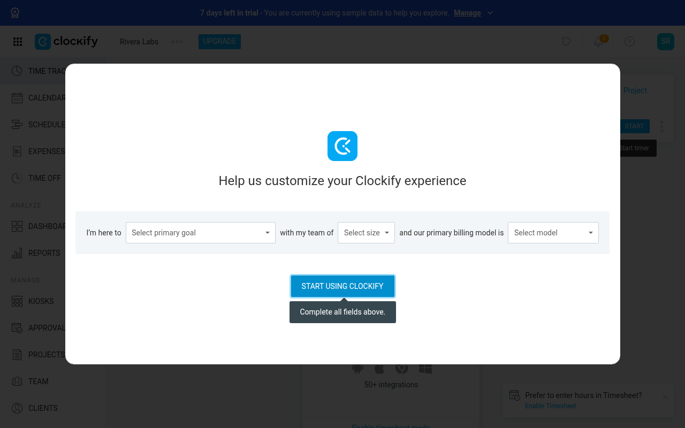
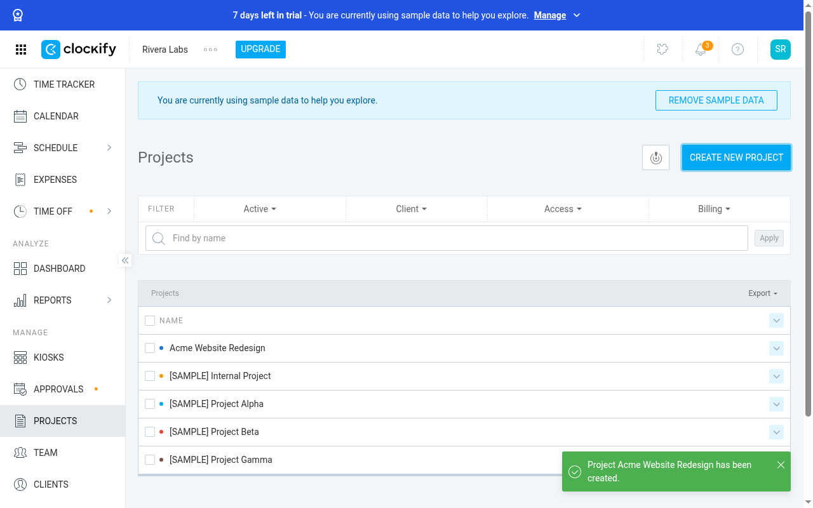
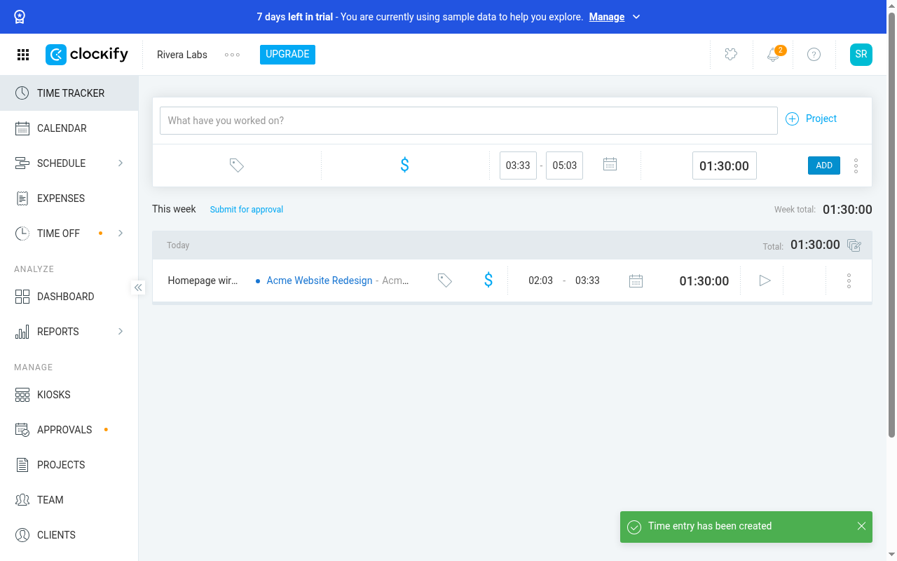
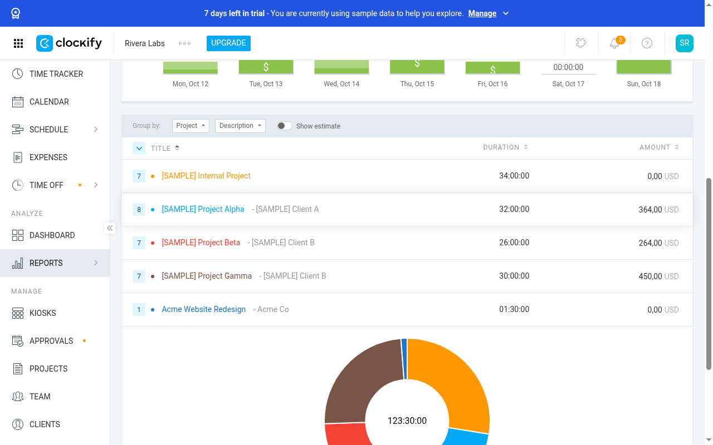

# Clockify (clockify.me): no-token MCP e2e

Report: [https://usersim.vercel.app/report?study= eb205e50-1cba-4b4c-84c5-f39747abd7c3](https://usersim.vercel.app/report?study= eb205e50-1cba-4b4c-84c5-f39747abd7c3) · Persona: Dana Kim, a freelance web designer who bills two clients by the hour · Engine b63f3d3

**Result: signup ✅, 3/3 tasks ✅ (judge reached, proof PASS on all 4 cells).**

## Signup (cell t1, 15 steps)
1. Opened clockify.me and went to its free signup.
2. `usersim_signup_identity` gave a fresh alias. Typed it in. **Clockify asks for no password**; signup is passwordless (email plus code).
3. Cloudflare Turnstile passed by itself.
4. `usersim_wait_for_verification_code` got "XXXXXX is your Clockify verification code" (6 characters). Typed it in.
5. Onboarding form ("Help us customize": 3 dropdowns), then signed in to the Clockify tracker.

## Tasks
| Cell | Task | Steps | Result |
|---|---|---|---|
| t2 | Create project *Acme Website Redesign* for new client *Acme Co* | 25 | ✅ project listed with client Acme Co |
| t3 | Log 1 h 30 min today on that project, description "Homepage wireframes" | 20 | ✅ entry 1:30:00 in the timesheet |
| t4 | Find a report of this week's hours by project | 12 | ✅ Reports › Summary shows Acme Website Redesign 01:30:00 |

Each later cell logged in to the same account with an **emailed login code** read through `same_account_as`.

## Actionable findings (Clockify UX)
1. **No password at signup.** Every return visit needs an emailed code, so a user without mail access can't sign in.
2. **Untranslated i18n keys exposed** as accessible names: `REGISTER.ENTER_VERIFICATION_CODE.ARIA_LABELS…`, `SHARED.COLOR_PICKER_ARIA_LABEL`. Screen readers read these out.
3. **Mandatory "Help us customize" modal** with 3 dropdowns. *Start* only shows a tooltip until all 3 are filled, and nothing says which one is missing.
4. **"Your trial starts today" Pro modal** appears on the free plan, which reads like you were enrolled in a paid trial.
5. **Sample data inflates real numbers**: the report shows 123:30 h and $1,078 of demo entries beside the 1:30 the user logged, and demo projects crowd the project list.
6. The notifications popover opens by itself on first load and covers the page.
7. **Manual time entry is hidden** behind a ⋮ menu. Its default start is *now*, so a 1:30 entry ends in the future unless you edit the start time.
8. A new client can only be created from a small "create 'Acme Co' Client" link in the dropdown, or with Ctrl+Enter. There is no visible button.
9. The project list hides the client column by default, so you can't confirm the project/client link you just made.
10. The Reports flyout stays open over the page after you pick a report.

## MCP issues this product exposed (fixed)
- The Clockify `cakeExchangeToken` **JWT was visible in public trace URLs** → redacted ([#79](https://github.com/ShreyasPatel031/UserSim/pull/79)).
- A fonts.googleapis.com link came back as "verification link 1" → web-font links are skipped ([#79](https://github.com/ShreyasPatel031/UserSim/pull/79)).
- Later cells could not log in, because the login code went to the first cell's alias → `same_account_as` ([#79](https://github.com/ShreyasPatel031/UserSim/pull/79)).
- The wait tool told agents to "open link 1" for a code-only mail → it now says to type the code ([#80](https://github.com/ShreyasPatel031/UserSim/pull/80)).
- A deploy restart wiped the first Clockify study (cc449ca4): cell 1 had passed, cells 2–4 were lost. It was redone as eb205e50, and accounts now survive restarts ([#80](https://github.com/ShreyasPatel031/UserSim/pull/80), [#81](https://github.com/ShreyasPatel031/UserSim/pull/81)).
