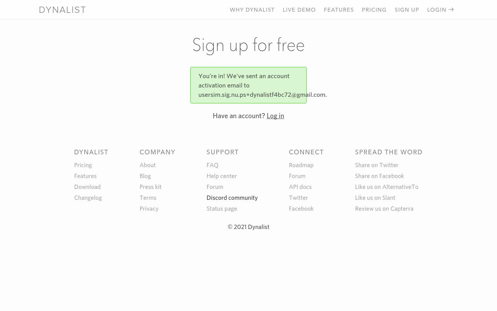
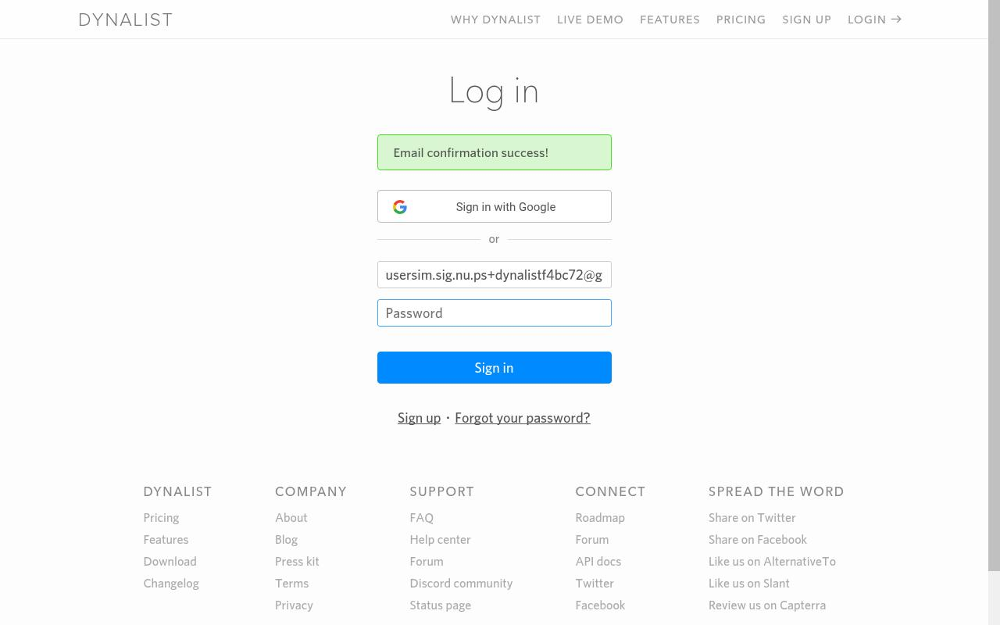
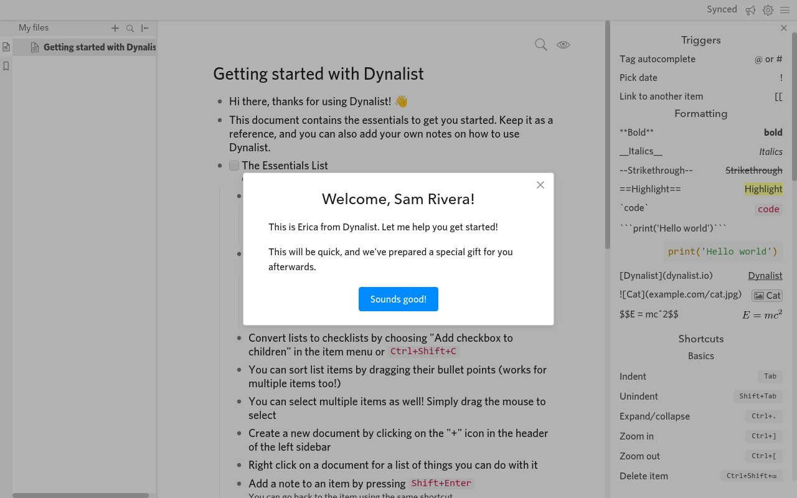
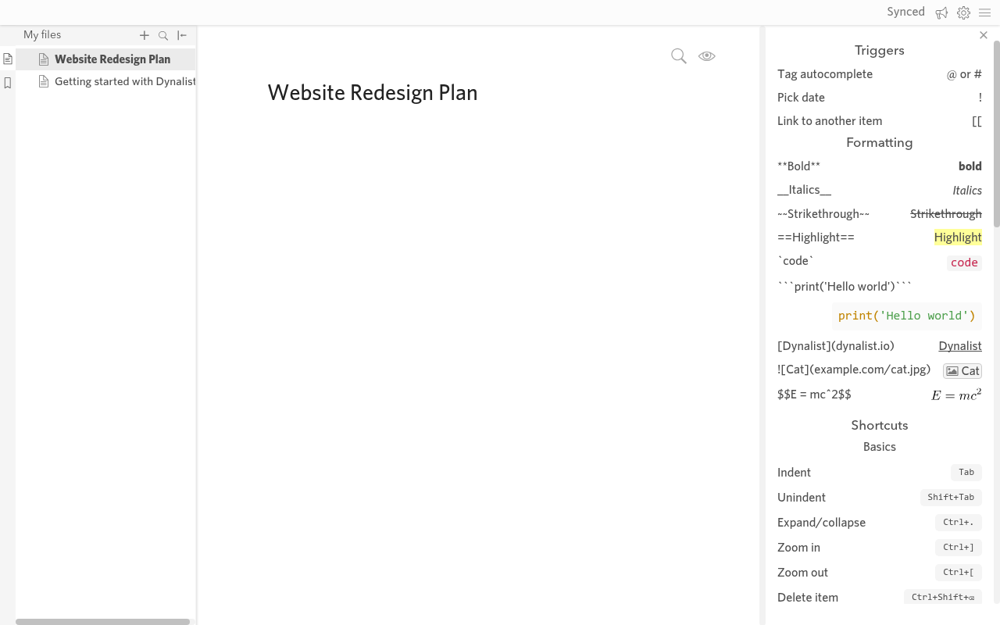
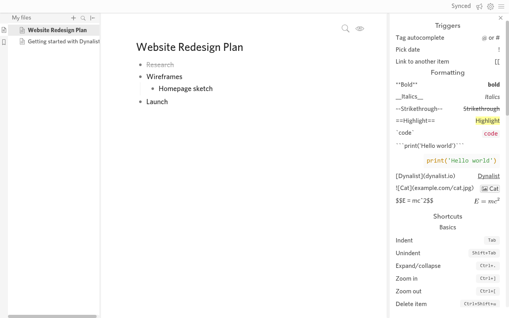
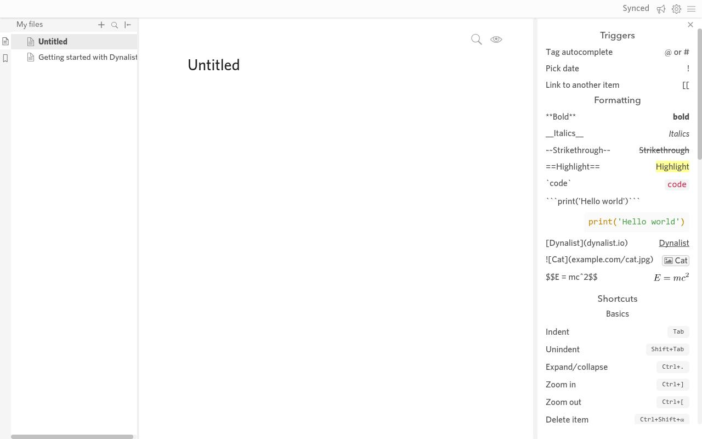

# Dynalist (dynalist.io): no-token MCP e2e

Report: [https://usersim.vercel.app/report?study= ab9fa612-f223-4ec8-bcff-5087400f3420](https://usersim.vercel.app/report?study= ab9fa612-f223-4ec8-bcff-5087400f3420) · Persona: Marcus Lee, a freelance product designer who plans in outlines · Engine 3f2b4fbd

**Result: signup ✅ (email link). Tasks 2 and 3 ✅. Task 4 was done in the browser (Research struck through after a reload), but the judge failed it on a verdict bug; the fix is ready but not merged. Proof PASS on all 4 cells.**

## Signup (cell t1, 8 steps), verified by **email link**
1. SIGN UP form: name, email (MCP alias), password. No captcha.
2. A green box says "You're in! We've sent an account activation email". 
3. `usersim_wait_for_verification_link` got "Dynalist Email Confirmation" with one *Confirm your email* link. `usersim_open_verification_link link_number=1` opened it.
4. The login page says "Email confirmation success!" with the email prefilled. 
5. Typed the password and landed in the app on *Getting started with Dynalist* with a Welcome modal.

## Tasks
| Cell | Task | Steps | Result |
|---|---|---|---|
| t2 | Create document *Website Redesign Plan* | 20 | ✅ sidebar + › New document, renamed from the title, synced; kept after a reload |
| t3 | Add Research, Wireframes (with Homepage sketch under it), Launch | 18 | ✅ Enter / Tab / Shift+Tab; kept after a reload |
| t4 | Check off Research | 11 | ✅ in the browser (item menu › Check off; struck through after a reload). ❌ judge, see below |

## Why task 4 says "NOT reached" (a judge bug, being fixed)
Judge: "did not check off the 'Research' item". Dynalist marks a completed item as grey struck-through text, and `innerText` drops that, so the DOM text the judge reads shows a plain "Research", and the vision model missed the faint strike. On the real frame: 6/6 FAIL.
**Fix 9928cd7 (not pushed):** the server reads struck-through text and ticked checkboxes from the final page into the judge's facts, and the prompt says struck-through means completed. Result: 6/6 PASS; the unstruck negative stays 0/6. After it's deployed, task 4 needs one rerun with `same_account_as=0893731d9b204f87ac4e5c88ee6409a0` (the account is saved on the server).

## Actionable findings (Dynalist UX)
1. **Unsynced edits are dropped on reload without warning.** I renamed the new document in the sidebar, reloaded about 2 s later, and it was *Untitled* again. The only sign was a small grey "Sync now" in the corner. 
2. **Confirming the email doesn't sign you in**: you type the password again right after signing up.
3. The login form shifts down when the red "What's your email?" banner appears, so the field you aimed at moves.
4. The **Sign up** button (and Google button) aren't exposed as buttons to assistive tech or automation.
5. Check off is buried: the item menu icon appears only on hover, and the menu has 20+ entries. Plain bullets have no checkbox until you choose *Add checkbox*.
6. The help/shortcut panel is open by default and takes about 25% of the width on first use.
7. The Welcome modal ("special gift afterwards") interrupts the first document.

## MCP issues this product exposed
- Judge misses struck-through "done" state → 9928cd7 (not pushed).
- My own login helper typed before the login page finished loading. The fix is a wait plus reading field positions from `fields`; there's no MCP change.
