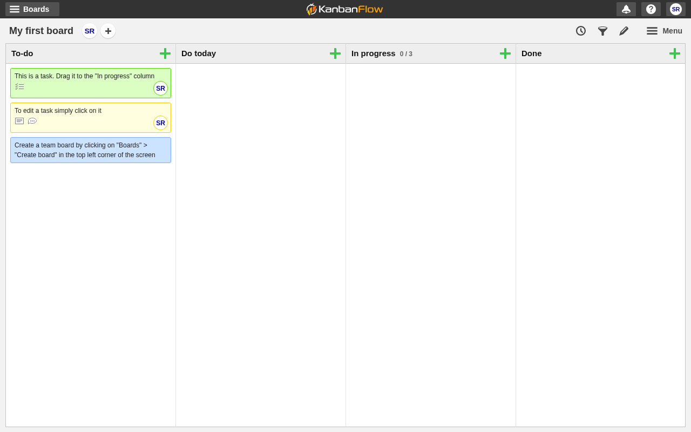
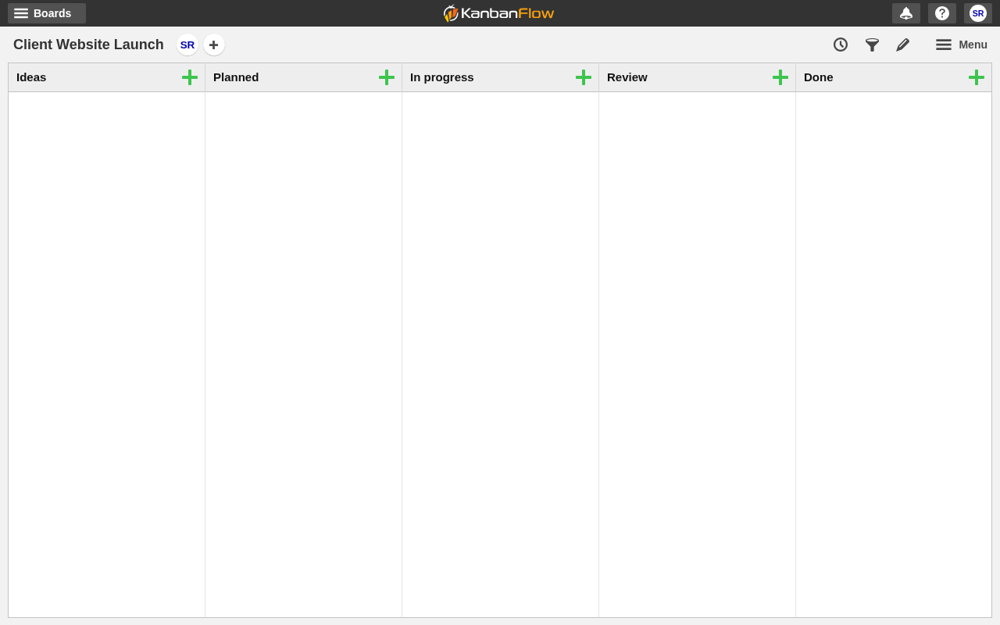
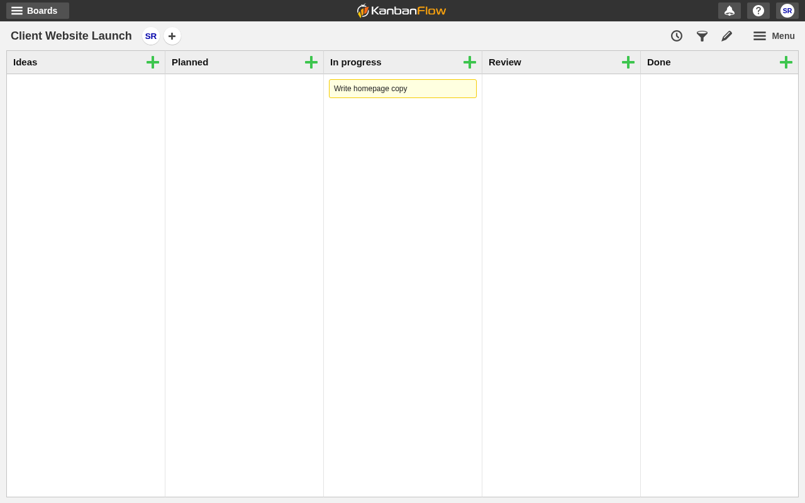
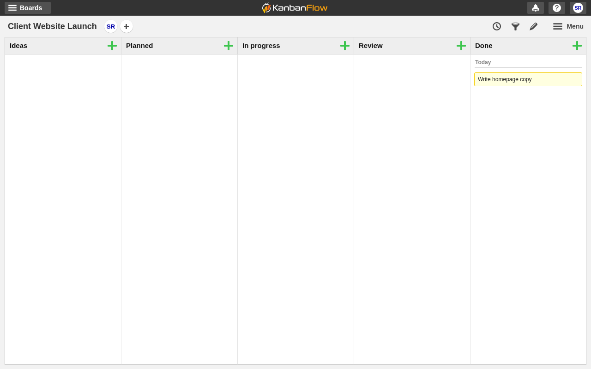
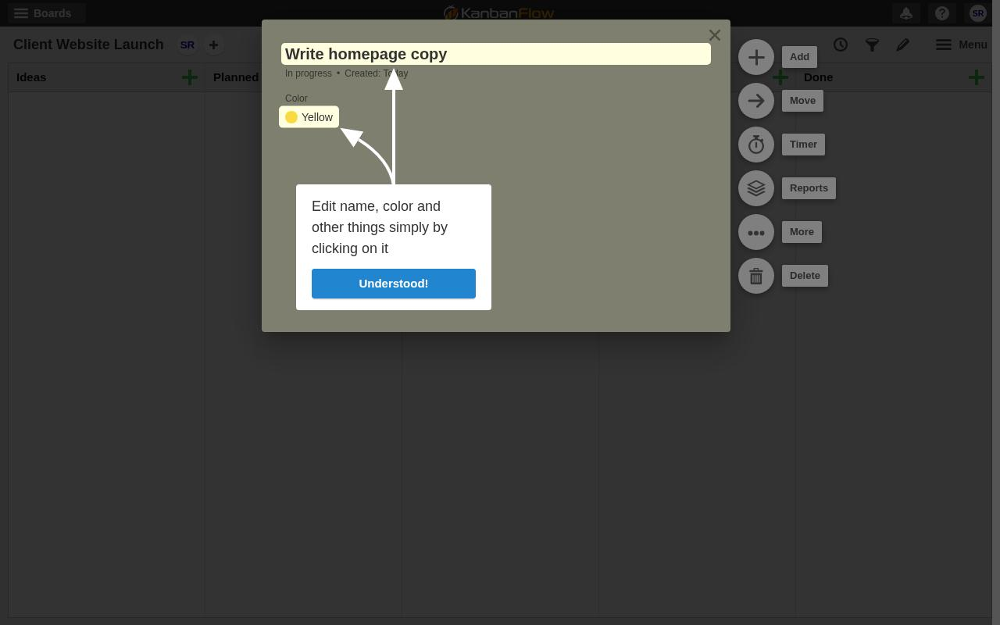
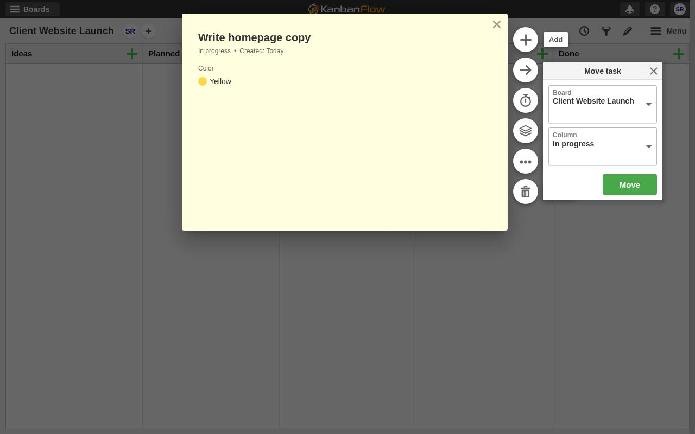

# KanbanFlow (kanbanflow.com): no-token MCP e2e

Report: [https://usersim.vercel.app/report?study=72c2fd88-e7a0-41f7-8bed-864142e1a5e6](https://usersim.vercel.app/report?study=72c2fd88-e7a0-41f7-8bed-864142e1a5e6) · task-4 reruns: [https://usersim.vercel.app/report?study=91651b7e-338f-4183-b3b9-b799e3b74e11](https://usersim.vercel.app/report?study=91651b7e-338f-4183-b3b9-b799e3b74e11), [https://usersim.vercel.app/report?study=9fe4e35e-c57e-4853-8821-837b057964d6](https://usersim.vercel.app/report?study=9fe4e35e-c57e-4853-8821-837b057964d6) · Persona: Priya Nair, marketing lead at a 5-person agency

**Result: signup ✅, 3/3 tasks ✅.** Task 4 passed (judge + proof) on rerun [e1be2256](https://usersim.vercel.app/report?study=e1be2256-d0ed-4da9-9b97-f14d13cf0fe2) on engine b0f7eecd. The 3 runs before it were done in the browser too, but failed on judge bugs, now fixed (below).

## Signup (cell t1, 9 steps)
1. Clicked SIGN UP, then typed name, email (MCP alias) and password, and ticked the terms checkbox. No captcha.
2. `usersim_wait_for_verification_code` got a 6-digit code ("[KanbanFlow] Your verification code"). Typed it into the 123-456 field.
3. Landed signed in on *My first board*.

## Tasks
| Cell | Task | Steps | Result |
|---|---|---|---|
| t2 | Create board *Client Website Launch* | 14 | ✅ 5-step wizard; chose the *Project management* template (Ideas, Planned, In progress, Review, Done) |
| t3 | Add *Write homepage copy*, move it to In progress | 12 | ✅ green + on Planned › Save & close, then dragged to In progress; still there after a reload |
| t4 | Mark it done so it sits in Done | 7 / 15 / 11 / 11 | ✅ final rerun e1be2256: card › Move › Column = Done, confirmed after a reload; judge reached, proof PASS |

Later cells logged in with email + password from `same_account_as`. The reruns used the account saved at signup, after a server restart.

## Why task 4 needed reruns (judge bugs, fixed)
| Run | Judge reason | Root cause | Fix |
|---|---|---|---|
| 72c2fd88 | "the screenshot shows it is already in the 'Done' column" | The judge sees only the final frame, so it took the asked-for end state as pre-existing | [#80](https://github.com/ShreyasPatel031/UserSim/pull/80) action log + end-state rule; [#82](https://github.com/ShreyasPatel031/UserSim/pull/82) moved the rule next to the task goal (my reproduction: 3/3 FAIL → 3/3 PASS) |
| 91651b7e | same | #80's wording was ignored | #82 |
| 9fe4e35e | "still in the 'Today' section of the 'Done' column, not in the main 'Done' column" | KanbanFlow groups Done by date, and the judge treated the *Today* group as a different column | **352f4ed**: a group inside a column is that column. Exact server inputs: 10/10 FAIL → 8/8 PASS; the In-progress negative stays 0/6 |
| e1be2256 | **reached**: "the final screenshot shows this task in the 'Done' column" | n/a | deployed b0f7eecd |

## Actionable findings (KanbanFlow UX)
1. **Opening a card fires two coach-mark tips in a row** ("Got it!", then "Understood!"). They block the card's action buttons until dismissed, and my first *Move* click was swallowed. 
2. The card's action buttons (Add, Move, Timer, Reports, More, Delete) are **icon-only with empty accessible names**; labels show only on hover.
3. There's no one-click "Done" button. Finishing a task means a drag, or card › Move › pick a column from a small popover with native dropdowns. 
4. The board wizard opens on Premium upsell and has 5 steps (template, columns, WIP limits, invites) just to make a board.
5. The green + on each column has no text label.
6. The Done column auto-groups by date ("Today"). That's handy, but it makes Done look like it has sub-sections.

## MCP issues this product exposed
- The wait tool said "open link 1" for a code mail with no links → fixed ([#80](https://github.com/ShreyasPatel031/UserSim/pull/80)).
- Judge end-state bugs above → [#80](https://github.com/ShreyasPatel031/UserSim/pull/80), [#82](https://github.com/ShreyasPatel031/UserSim/pull/82), 352f4ed.
- The `select` step showed in the trace without its option → 352f4ed.
- The native `<select>` in the Move popover was missing from `fields` (open; `select` by label still worked).
